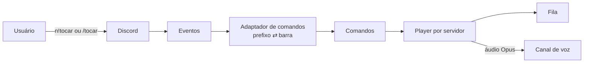

<div align="center">

<picture>
  <source media="(prefers-color-scheme: dark)" srcset="assets/logo-dark.png">
  
</picture>

### Um comando e a música começa.

Bot de música para Discord, em português e inglês. Entre em um canal de voz, digite `n!tocar` com o nome ou o link da música e pronto.

[](https://neruz.cloud)
[](https://discord.com/oauth2/authorize?client_id=1554972323365523536&scope=bot+applications.commands&permissions=4298198016)
[](https://www.instagram.com/neruzbot)


</div>

> 🔒 **Versão de visualização.** Este repositório mostra a estrutura, os comandos e a qualidade do código do projeto. **Não é open source:** o núcleo (player, extração de áudio, integrações, segurança e deploy) é privado. Veja a [licença](LICENSE).

## Use o Neruz

| | |
|---|---|
| 🌐 **Site e documentação** | [neruz.cloud](https://neruz.cloud) |
| ➕ **Adicionar ao seu servidor** | [Convite oficial](https://discord.com/oauth2/authorize?client_id=1554972323365523536&scope=bot+applications.commands&permissions=4298198016) |
| 📸 **Novidades** | [@neruzbot no Instagram](https://www.instagram.com/neruzbot) |

O site tem a documentação completa (comandos, perguntas frequentes, privacidade e tecnologia) e um simulador do chat do Discord para testar os comandos no navegador, sem instalar nada. O uso é gratuito, sem cadastro e sem anúncios.

## O que o Neruz faz

- Toca músicas e **playlists completas** a partir de links ou busca por nome
- Aceita **YouTube, Spotify, SoundCloud** e outras fontes, além de **arquivos de áudio**
- **Fila por servidor:** ver, remover, mover, embaralhar, pular, voltar, loop e volume
- Painel **"Tocando agora"** com botões e emojis próprios
- **22 comandos**, digitados (`n!tocar`, `n.tocar`) ou de barra (`/tocar`), cada um em **português e inglês**
- Recupera-se sozinho de quedas de conexão e economiza recursos quando o canal esvazia
- Voz com criptografia de ponta a ponta (**DAVE**), padrão atual do Discord

Lista completa de comandos: [docs/04-comandos.md](docs/04-comandos.md).

## Exemplo

```
n!tocar henrique e juliano liberdade provisória
n!playlist https://open.spotify.com/playlist/...
n!fila
n!pular
n!pausar
```

## Arquitetura (visão geral)



- **Um núcleo, dois estilos de comando:** um adaptador faz mensagens como `n!tocar` se comportarem como comandos de barra, então a mesma implementação atende os dois.
- **Um player por servidor**, com operações serializadas para evitar conflitos.
- **Camadas separadas:** comandos, domínio (fila), apresentação (embeds e botões) e integrações.
- **Fila pura e testável:** sem dependência do Discord.

## Tecnologias

TypeScript (modo estrito) · Node.js 24 · discord.js 14 · @discordjs/voice · FFmpeg · zod · pino · vitest · Docker

## Estrutura

```
src/
├── commands/     Comandos de barra (tocar, controles, fila, ajuda)
├── prefix/       Comandos digitados (n!, n.) e adaptador
├── events/       Eventos do Discord (interações, mensagens, voz)
├── music/        Fila, faixas e gerenciador de players
├── ui/           Embeds e botões
├── utils/        Formatação, detecção de links, validações de voz
└── core/         Erros, tipos e logger
tests/            Testes automatizados da fila, formatação, links e comandos
```

> 🔒 Módulos privados, não incluídos aqui: reprodução e conexão de voz por servidor, resolução de faixas, extração e streaming de áudio, integração com Spotify, correspondência de músicas, proteções de segurança, scripts e infraestrutura de deploy. Por isso este repositório não compila sozinho.

## Qualidade

- TypeScript estrito, validação de configuração com zod e logs estruturados
- 100 testes automatizados no projeto completo (os testes das partes públicas estão em `tests/`)
- Dependências auditadas, sem vulnerabilidades conhecidas
- Roda 24 h em VPS, em container sem privilégios, sem portas abertas

## Desenvolvimento

Desenvolvido por **[Fonte Dev](https://fontedev.com) · Bruno Lucas**.

O Neruz Bot é um projeto independente e não tem afiliação com Discord, YouTube ou Spotify. Os nomes e marcas citados pertencem aos seus respectivos donos.

© 2026 Bruno Lucas. Todos os direitos reservados. O nome Neruz e a identidade visual (pasta `assets/`) não podem ser reutilizados sem autorização.
